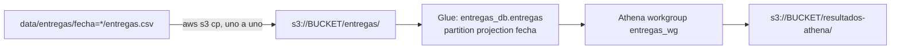

# Entregas de paquetes: S3 + Glue (partition projection) + Athena

Solución del punto **DE-Final-Entregas**. El enunciado original está en
[`ENUNCIADO.md`](ENUNCIADO.md).



## Estructura

| Ruta | Contenido |
| --- | --- |
| `infraestructura/` | Terraform: bucket privado, base de datos y tabla de Glue con partition projection, workgroup de Athena y outputs. |
| `consultas/` | SQL de la demostración inicial y de la verificación del tercer día. |
| `scripts/ejecutar_athena.py` | Ejecuta un `.sql` en Athena con la AWS CLI, guarda el CSV, registra el ID de ejecución y compara con la referencia. |
| `resultados/inicial/`, `resultados/final/` | Resultados obtenidos en Athena por etapa. |
| `resultados_esperados/` | Referencias suministradas (no se suben a S3). |
| `evidencias/` | Salida de `terraform apply`, outputs, registro de ejecuciones de Athena y salida de `terraform destroy`. |
| `respuestas.md` | Respuestas conceptuales. |

## Prerrequisitos

- Cuenta de AWS propia con permisos sobre S3, Glue y Athena.
- [AWS CLI v2](https://docs.aws.amazon.com/cli/latest/userguide/getting-started-install.html) configurada (`aws configure` o `aws sso login`).
  Comprobar con `aws sts get-caller-identity`.
- [Terraform](https://developer.hashicorp.com/terraform/install) >= 1.5 (proveedor `hashicorp/aws ~> 5.0`).
- Python 3 (solo librería estándar) para `scripts/ejecutar_athena.py`.
- Bash/zsh (macOS o Linux/WSL2).

## Configuración

| Variable | Valor por defecto | Descripción |
| --- | --- | --- |
| `region` | `us-east-1` | Región de todos los recursos. |
| `nombre_bucket` | `de-final-entregas-jeroespinal-2026` | Nombre único global del bucket. Cámbielo si ya existe. |
| `nombre_base_datos` | `entregas_db` | Base de datos de Glue. |
| `nombre_tabla` | `entregas` | Tabla externa. |
| `nombre_workgroup` | `entregas_wg` | Workgroup de Athena. |
| `fecha_inicio_proyeccion` / `fecha_fin_proyeccion` | `2026-10-01` / `2026-10-03` | Rango de la proyección (incluidos). |

Para usar otros valores sin publicarlos: `-var="nombre_bucket=..."` o un
`terraform.tfvars` (ignorado por `.gitignore`).

### Tabla `entregas`

- Columnas en el orden del CSV: `id_envio string`, `ciudad string`,
  `transportadora string`, `estado string`, `duracion_minutos int`.
- `LazySimpleSerDe` con `field.delim=","` y `skip.header.line.count=1`.
- Clave de partición `fecha string` (sale de la carpeta, no del archivo).
- Partition projection: `type=date`, `format=yyyy-MM-dd`,
  `range=2026-10-01,2026-10-03`, `interval=1`, `interval.unit=DAYS`,
  `storage.location.template=s3://<bucket>/entregas/fecha=${fecha}/`.

No se crean particiones individuales en ningún momento.

## 1. Despliegue

Todos los comandos se ejecutan desde la raíz del repositorio.

```bash
aws sts get-caller-identity

terraform -chdir=infraestructura init
terraform -chdir=infraestructura fmt -check
terraform -chdir=infraestructura validate
terraform -chdir=infraestructura plan

terraform -chdir=infraestructura apply -auto-approve -no-color \
  | tee evidencias/aplicacion_terraform.txt

terraform -chdir=infraestructura output -json > evidencias/outputs.json

export BUCKET=$(terraform -chdir=infraestructura output -raw bucket)
export AWS_REGION=$(terraform -chdir=infraestructura output -raw region)
echo "$BUCKET  $AWS_REGION"
```

## 2. Demostración inicial: días 1 y 2

Se cargan **solo** los dos primeros archivos, uno por uno (sin carga recursiva):

```bash
aws s3 cp "data/entregas/fecha=2026-10-01/entregas.csv" "s3://$BUCKET/entregas/fecha=2026-10-01/entregas.csv"
aws s3 cp "data/entregas/fecha=2026-10-02/entregas.csv" "s3://$BUCKET/entregas/fecha=2026-10-02/entregas.csv"
aws s3 ls "s3://$BUCKET/entregas/" --recursive
```

Consultas iniciales (cada ejecución queda en `evidencias/ejecuciones_athena.csv`
con etapa `inicial`):

```bash
python3 scripts/ejecutar_athena.py --etapa inicial \
  --sql consultas/intentos_por_fecha_estado.sql \
  --salida resultados/inicial/intentos_por_fecha_estado.csv \
  --esperado resultados_esperados/intentos_por_fecha_estado_inicial.csv

python3 scripts/ejecutar_athena.py --etapa inicial \
  --sql consultas/porcentaje_exito_por_fecha_ciudad.sql \
  --salida resultados/inicial/porcentaje_exito_por_fecha_ciudad.csv \
  --esperado resultados_esperados/porcentaje_exito_por_fecha_ciudad_inicial.csv

python3 scripts/ejecutar_athena.py --etapa inicial \
  --sql consultas/duracion_promedio_2026-10-02.sql \
  --salida resultados/inicial/duracion_promedio_2026-10-02.csv \
  --esperado resultados_esperados/duracion_promedio_2026-10-02.csv
```

En esta etapa hay 12 registros: el rango ya incluye 2026-10-03, pero su prefijo
está vacío, así que no aparece en los resultados.

## 3. Nueva fecha: día 3

Sin tocar Terraform ni la tabla, se sube **solo** el tercer archivo y se consulta:

```bash
aws s3 cp "data/entregas/fecha=2026-10-03/entregas.csv" "s3://$BUCKET/entregas/fecha=2026-10-03/entregas.csv"

python3 scripts/ejecutar_athena.py --etapa final \
  --sql consultas/verificacion_tercer_dia.sql \
  --salida resultados/final/verificacion_tercer_dia.csv \
  --salida resultados/final/conteo_estados_tercer_dia.csv \
  --salida resultados/final/registros_por_fecha.csv \
  --salida resultados/final/total_registros_tabla.csv

python3 scripts/ejecutar_athena.py --etapa final \
  --sql consultas/intentos_por_fecha_estado.sql \
  --salida resultados/final/intentos_por_fecha_estado.csv \
  --esperado resultados_esperados/intentos_por_fecha_estado_final.csv

python3 scripts/ejecutar_athena.py --etapa final \
  --sql consultas/porcentaje_exito_por_fecha_ciudad.sql \
  --salida resultados/final/porcentaje_exito_por_fecha_ciudad.csv \
  --esperado resultados_esperados/porcentaje_exito_por_fecha_ciudad_final.csv
```

No se ejecutaron crawlers, `MSCK REPAIR TABLE`, `ALTER TABLE ADD PARTITION` ni
cambios en las propiedades de la tabla. `verificacion_tercer_dia.sql` contiene
cuatro sentencias (Athena ejecuta una por consulta); el script guarda cada una
en su CSV:

| CSV | Demuestra |
| --- | --- |
| `resultados/final/verificacion_tercer_dia.csv` | Los 6 registros de 2026-10-03. |
| `resultados/final/conteo_estados_tercer_dia.csv` | Conteos por estado del día 3 (3 ausentes, 1 dirección incorrecta, 2 entregados). |
| `resultados/final/registros_por_fecha.csv` | 6 registros por cada una de las tres fechas. |
| `resultados/final/total_registros_tabla.csv` | Total de 18 registros. |

La duración promedio sigue correspondiendo al día 2 y usa la referencia inicial.

## 4. Limpieza

Primero se guardan y confirman las evidencias. Luego:

```bash
# (Opcional) vaciar el bucket; force_destroy=true también permite borrarlo con objetos
aws s3 rm "s3://$BUCKET" --recursive

terraform -chdir=infraestructura destroy -auto-approve -no-color \
  | tee evidencias/eliminacion_terraform.txt

aws s3 ls "s3://$BUCKET" 2>&1 | head -1          # debe indicar NoSuchBucket
aws glue get-database --name entregas_db 2>&1 | head -1   # EntityNotFoundException
aws athena get-work-group --work-group entregas_wg 2>&1 | head -1   # InvalidRequestException
```

`terraform destroy` elimina el bucket (con datos y resultados de Athena), la
base de datos y la tabla de Glue y el workgroup (con su historial). Los
archivos `.tfstate` y `.terraform/` quedan fuera del repositorio.
